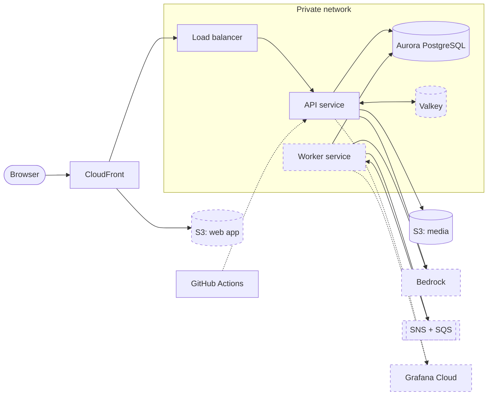

# DevCool

A real-time chat and collaboration platform backend built with **Spring Boot 3.5 / Java 21**, designed around **Hexagonal Architecture** and deployed on AWS.

## Table of Contents

- [Introduction](#introduction)
- [Tech Stack](#tech-stack)
- [Hexagonal Architecture](#hexagonal-architecture)
- [AWS Architecture](#aws-architecture)
- [Local Development](#local-development)
- [Running Tests](#running-tests)
- [API Docs](#api-docs)

---

## Introduction

DevCool is a backend API service that powers a developer-focused chat platform. It supports:

- **Authentication** — JWT-based auth with access tokens and HttpOnly refresh token cookies
- **Channels** — Forum, Lounge, and Private Chat channel types with membership management
- **Real-time messaging** — Raw WebSocket connections with custom message protocol (Subscribe / Unsubscribe / SendMessage)
- **Media uploads** — Multipart file upload to S3 (JPEG, PNG, WebP, MP4; max 10 MB) with presigned URL retrieval

The codebase enforces strict layering so that domain logic never depends on Spring, JPA, or AWS — making it easy to test in isolation and swap infrastructure adapters without touching business rules.

---

## Tech Stack

| Concern | Technology |
|---|---|
| Language | Java 21 |
| Framework | Spring Boot 3.5.6 |
| Database | PostgreSQL 16 (Aurora Serverless v2 on AWS) |
| ORM / Migrations | Spring Data JPA + Flyway |
| Auth | JWT (nimbus-jose-jwt) |
| Storage | AWS S3 (SDK v2, region: `us-east-1`) |
| WebSocket | Spring WebSocket (raw, not STOMP) |
| Code generation | Lombok + MapStruct 1.5.5 |
| API Docs | SpringDoc OpenAPI (Swagger UI at `/docs`) |
| Build | Maven 3.9+ |
| Code quality | Spotless (Google Java Format), SpotBugs, ArchUnit |
| Test coverage | JaCoCo + optional SonarQube |

---

## Hexagonal Architecture

The project follows the **Ports & Adapters (Hexagonal) pattern** — the domain and application layers are completely isolated from framework and infrastructure concerns.

### Layer Overview

```
com.devcool/
├── domain/              # Pure business logic — zero Spring/JPA/AWS imports
│   ├── auth/            # JWT tokens, refresh tokens
│   ├── user/            # User, Role, UserStatus
│   ├── channel/         # Channel types (Forum, Lounge, PrivateChat)
│   ├── chat/            # Messages
│   ├── member/          # Channel membership
│   ├── media/           # Media upload (S3)
│   └── common/          # Shared domain primitives
│
├── application/
│   └── service/         # Use case implementations — wires domain ports together
│
└── adapters/
    ├── in/
    │   ├── web/          # REST controllers + request/response DTOs (MapStruct mappers)
    │   └── websocket/    # WebSocket handlers + auth handshake interceptor
    └── out/
        ├── persistence/  # JPA entities + Spring Data repositories
        ├── storage/      # S3StorageAdapter (AWS SDK v2)
        ├── jwt/          # JWT issuance and validation
        └── crypto/       # BCrypt password hashing
```

### Port Pattern

Each domain module defines:

- **Inbound ports** (`UseCase` / `Query` interfaces) — called by `adapters/in`
- **Outbound ports** (`Port` interfaces) — implemented by `adapters/out`

Application services implement inbound ports and depend **only** on outbound port interfaces — never directly on JPA repositories or the AWS SDK.

```
HTTP Request
    │
    ▼  adapters/in/web/controller        (HTTP → command object)
    │
    ▼  domain/.../port/in/UseCase        (inbound port interface)
    │
    ▼  application/service/...Service    (implements UseCase, calls Port)
    │
    ▼  domain/.../port/out/...Port       (outbound port interface)
    │
    ▼  adapters/out/...Adapter           (JPA / S3 / JWT implementation)
```

### Example: Media Upload Request Flow

```
POST /api/v1/medias/upload (MultipartFile + channelId)
  │
  ▼ MediaController
    - Extracts userId from Spring Security principal
    - Calls MediaDtoMapper.toUploadMediaCommand(file, userId, channelId)
  │
  ▼ UploadMediaUseCase  [inbound port]
  │
  ▼ MediaService
    - Validates file not empty → InvalidMediaContentException
    - Validates contentType in allowlist → UnsupportedMediaTypeException
    - Builds S3 key: "channel/{channelId}/{yyyy/MM/dd}/{uuid}.{ext}"
    - Calls MediaStoragePort.upload(UploadRequest)
  │
  ▼ MediaStoragePort  [outbound port]
  │
  ▼ S3StorageAdapter
    - Builds AWS PutObjectRequest
    - Calls s3Client.putObject(...)
    - Returns UploadResult(bucket, objectKey)
  │
  ▼ HTTP 200 { "data": { "key": "channel/123/2026/03/08/uuid.jpg" } }
```

### Boundaries enforced

| Boundary | Rule |
|---|---|
| Domain | No Spring, JPA, or AWS imports |
| Application service | Depends only on port interfaces — never on `@Repository` beans or SDKs |
| Controllers | Only map HTTP types → domain commands; no business logic |
| Domain exceptions | Thrown from the service layer; caught by a global `@ControllerAdvice` |

---

## AWS Architecture

DevCool runs on AWS. All infrastructure is defined as code with Terraform (`infra/`), and GitHub Actions deploys it automatically. The diagram shows the target design; dashed boxes aren't built yet.



| Component | Status | Role |
|---|---|---|
| **CloudFront** | Available | Single public entry point: serves the web app and forwards API and WebSocket traffic to the backend |
| **Load balancer** | Available | Spreads requests across backend containers and only sends traffic to healthy ones |
| **API service** (ECS Fargate) | Available | Runs the Spring Boot backend (REST and WebSocket) as containers, adding more under load |
| **Aurora PostgreSQL** | Available | Managed database that scales down, and pauses, when idle |
| **S3: media** | Available | Stores files users upload in chat |
| **Secrets Manager** | Available | Holds passwords and keys, given to the app at startup |
| **GitHub Actions** | Available | Tests, builds and deploys every change merged into `master` |
| **S3: web app** (React) | Unavailable | The browser client, served through CloudFront |
| **Valkey** | Unavailable | Shares realtime messages, presence and typing across API containers |
| **Worker service** | Unavailable | Runs background jobs (notifications, cleanup, AI indexing) off the request path |
| **SNS + SQS** | Unavailable | Durable event queues between the API and the worker |
| **Bedrock** | Unavailable | AI answers over chat history and the embeddings that power search |
| **Grafana Cloud** | Unavailable | Metrics, logs and traces from every service, with dashboards and alerts |

The backend and database sit in a private network that isn't reachable from the internet. Passwords and keys are kept in AWS Secrets Manager and given to the app when it starts, never stored in code.

### Deployment flow

1. A change is merged into `master`.
2. GitHub Actions builds a Docker image and pushes it to AWS.
3. Database migrations run as a separate step before any new code goes live.
4. The new containers replace the old ones gradually. If they fail their health checks, AWS rolls back to the previous version.

Infrastructure changes are previewed on the pull request and applied after merge. To save cost, the dev environment can be paused and resumed from a workflow.

More detail:
- Operating the environment: [`infra/README.md`](infra/README.md)
- Running the production image locally: [`docker/ecs/README.md`](docker/ecs/README.md)

---

## Local Development

### Prerequisites

- Java 21+
- Maven 3.9+
- Docker (for PostgreSQL via Docker Compose)
- AWS credentials configured (for S3 — can use a local bucket or LocalStack)

### Setup

1. Clone the repository.
2. Copy `local.env` and fill in your JWT secrets and AWS credentials.
3. Start the application — Spring Boot will automatically start the PostgreSQL container:

```bash
./mvnw spring-boot:run -Dspring-boot.run.arguments="--spring.profiles.active=local"
```

Docker Compose spins up:
- **PostgreSQL 16** on `localhost:5432`
- **pgAdmin 4** on `http://localhost:5050`

### Useful commands

```bash
# Build (skip tests)
./mvnw clean package -DskipTests

# Format code
./mvnw spotless:apply

# Check formatting
./mvnw spotless:check

# Static analysis (SpotBugs)
./mvnw -B -q -DskipTests -DskipITs -Pstatic-analysis verify
```

---

## Running Tests

```bash
# Unit tests only
./mvnw test

# Unit + integration tests (*IT classes; needs Docker) + coverage floor
./mvnw -Dit verify

# Unit tests + coverage report (integration tests don't run without -Dit)
./mvnw verify
```

Coverage report is generated at `target/site/jacoco/index.html`.

### Integration tests

`*IT` classes need Docker running (Testcontainers starts `pgvector/pgvector:pg16`).

**Docker Desktop on Linux:** if Ryuk fails to start, run this, then restart the machine:

```bash
echo 'TESTCONTAINERS_DOCKER_SOCKET_OVERRIDE=/var/run/docker.sock' >> ~/.config/environment.d/docker.conf
```

### CI Pipeline

Every pull request and every push to `master` runs `.github/workflows/ci.yml`. Any failing step fails the run:

1. Spotless format check
2. Unit tests + integration tests + JaCoCo line-coverage floor + SpotBugs, in one `./mvnw -Dit -Pstatic-analysis verify`
3. SonarCloud analysis (always; needs the `SONAR_TOKEN` repo secret)
4. Test and JaCoCo reports uploaded as artifacts

---

## API Docs

Swagger UI is available at `/docs` once the application is running.

> Full API reference will be added here.
