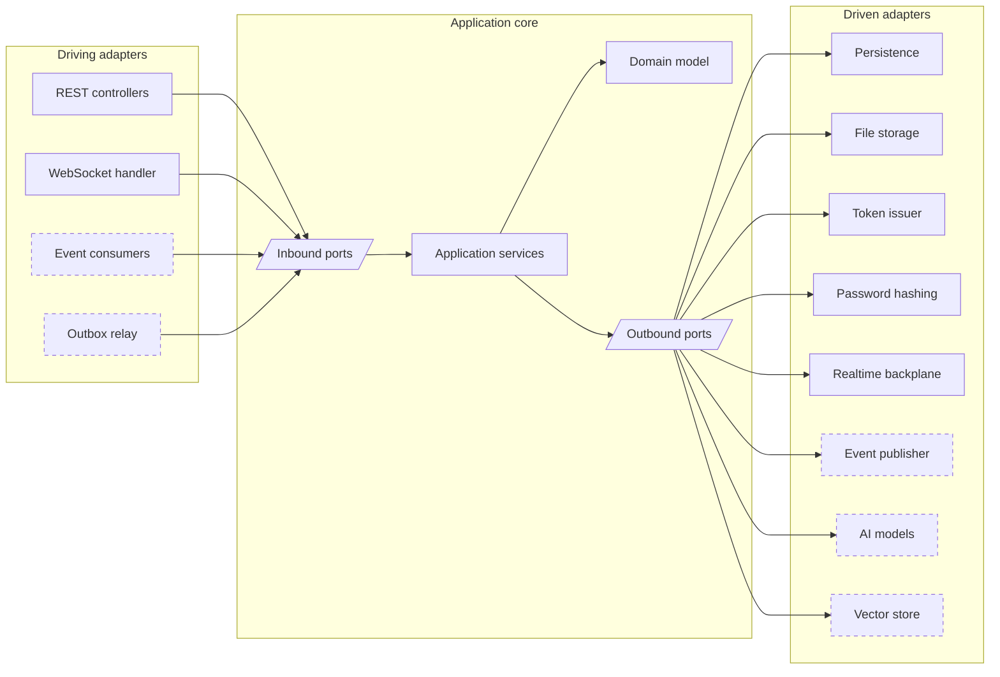

# DevCool

A real-time chat and collaboration platform backend built with **Spring Boot 3.5 / Java 21**, designed around **Hexagonal Architecture** and deployed on AWS.

## Table of Contents

- [Highlights](#highlights)
- [Tech Stack](#tech-stack)
- [Hexagonal Architecture](#hexagonal-architecture)
- [AWS Architecture](#aws-architecture)
- [Local Development](#local-development)
- [Running Tests](#running-tests)
- [API Docs](#api-docs)

---

## Highlights

- **Clean, enforced architecture**: hexagonal (ports and adapters). Business logic never depends on Spring, the database or AWS, and automated architecture tests keep it that way.
- **Reliable messaging**: a message is saved before it's acknowledged or broadcast; retries never create duplicates; every channel keeps a strict order; clients catch up after reconnecting. *(in progress)*
- **Realtime at scale**: WebSocket connections spread across many servers, with presence, typing indicators and no dropped users during deploys. *(planned)*
- **Event-driven background work**: slow jobs leave the request path through durable queues, with retries and dead-letter queues. *(planned)*
- **Permission-aware AI assistant**: ask questions about your chat history and get cited answers, built only from conversations you're allowed to see. *(planned)*
- **Infrastructure as code, keyless deploys**: all of AWS is defined in Terraform; GitHub Actions deploys without stored cloud keys and rolls back failed releases automatically.
- **Scale-to-zero cost design**: the dev environment sleeps or hibernates when idle, costing a few dollars a month, with budget alerts.
- **Quality and supply-chain gates**: every change passes tests, a coverage floor, static analysis and vulnerability scans of the code, image and infrastructure.
- **Observability with user-facing SLOs**: metrics, logs and traces from every service, with targets on what users feel, such as message delivery time. *(planned)*
- **Load- and chaos-tested**: soak tests, reconnect storms and failure drills, with published results. *(planned)*

---

## Tech Stack

| Concern | Technology |
|---|---|
| Language | Java 21 |
| Framework | Spring Boot 3.5.6 |
| Database | PostgreSQL 16 (Aurora Serverless v2 on AWS) |
| ORM / Migrations | Spring Data JPA + Flyway |
| Auth | JWT (nimbus-jose-jwt) |
| Storage | AWS S3 (SDK v2, region: `us-east-1`) |
| WebSocket | Spring WebSocket (raw, not STOMP) |
| Code generation | Lombok + MapStruct 1.5.5 |
| API Docs | SpringDoc OpenAPI (Swagger UI at `/docs`) |
| Build | Maven 3.9+ |
| Code quality | Spotless (Google Java Format), SpotBugs, ArchUnit |
| Test coverage | JaCoCo + optional SonarQube |

---

## Hexagonal Architecture

The project follows the **Ports & Adapters (Hexagonal) pattern** — the domain and application layers are completely isolated from framework and infrastructure concerns.



Dashed boxes aren't built yet. The core defines two kinds of interfaces:

- **Inbound ports** (`UseCase` / `Query`): what the application can do, called by driving adapters
- **Outbound ports** (`Port`): what the application needs from the outside world, implemented by driven adapters

| Part | Status | What it is |
|---|---|---|
| **REST controllers** | Available | Turn HTTP requests into calls on inbound ports |
| **WebSocket handler** | Available | Receives realtime frames (subscribe, send) and pushes messages to clients |
| **Event consumers** | Unavailable | React to queued events (notifications, AI indexing) |
| **Outbox relay** | Unavailable | Publishes saved events to the queues, so no event is lost |
| **Inbound ports** | Available | The use cases the application offers |
| **Application services** | Available | Implement the use cases by coordinating the domain and outbound ports |
| **Domain model** | Available | Business rules for users, auth, channels, members, chat and media; no framework code |
| **Outbound ports** | Available | Interfaces for everything the core needs from outside |
| **Persistence** | Available | Stores data in PostgreSQL |
| **File storage** | Available | Stores uploaded media in S3 |
| **Token issuer** | Available | Issues and verifies login tokens |
| **Password hashing** | Available | Hashes and checks passwords |
| **Realtime backplane** | Available (single server) | Delivers live messages between connections; in memory today, shared across servers with Valkey later |
| **Event publisher** | Unavailable | Sends domain events to the queues |
| **AI models** | Unavailable | Generates answers and embeddings |
| **Vector store** | Unavailable | Finds chat history relevant to a question |

---

## AWS Architecture

DevCool runs on AWS. All infrastructure is defined as code with Terraform (`infra/`), and GitHub Actions deploys it automatically. The diagram shows the target design; dashed boxes aren't built yet.


| Component | Status | Role |
|---|---|---|
| **CloudFront** | Available | Single public entry point: serves the web app and forwards API and WebSocket traffic to the backend |
| **Load balancer** | Available | Spreads requests across backend containers and only sends traffic to healthy ones |
| **API service** (ECS Fargate) | Available | Runs the Spring Boot backend (REST and WebSocket) as containers, adding more under load |
| **Aurora PostgreSQL** | Available | Managed database that scales down, and pauses, when idle |
| **S3: media** | Available | Stores files users upload in chat |
| **Secrets Manager** | Available | Holds passwords and keys, given to the app at startup |
| **GitHub Actions** | Available | Tests, builds and deploys every change merged into `master` |
| **S3: web app** (React) | Unavailable | The browser client, served through CloudFront |
| **Valkey** | Unavailable | Shares realtime messages, presence and typing across API containers |
| **Worker service** | Unavailable | Runs background jobs (notifications, cleanup, AI indexing) off the request path |
| **SNS + SQS** | Unavailable | Durable event queues between the API and the worker |
| **Bedrock** | Unavailable | AI answers over chat history and the embeddings that power search |
| **Grafana Cloud** | Unavailable | Metrics, logs and traces from every service, with dashboards and alerts |

The backend and database sit in a private network that isn't reachable from the internet. Passwords and keys are kept in AWS Secrets Manager and given to the app when it starts, never stored in code.

### Deployment flow

1. A change is merged into `master`.
2. GitHub Actions builds a Docker image and pushes it to AWS.
3. Database migrations run as a separate step before any new code goes live.
4. The new containers replace the old ones gradually. If they fail their health checks, AWS rolls back to the previous version.

Infrastructure changes are previewed on the pull request and applied after merge. To save cost, the dev environment can be paused and resumed from a workflow.

More detail:
- Operating the environment: [`infra/README.md`](infra/README.md)
- Running the production image locally: [`docker/ecs/README.md`](docker/ecs/README.md)

---

## Local Development

### Prerequisites

- Java 21+
- Maven 3.9+
- Docker (for PostgreSQL via Docker Compose)
- AWS credentials configured (for S3 — can use a local bucket or LocalStack)

### Setup

1. Clone the repository.
2. Copy `local.env` and fill in your JWT secrets and AWS credentials.
3. Start the application — Spring Boot will automatically start the PostgreSQL container:

```bash
./mvnw spring-boot:run -Dspring-boot.run.arguments="--spring.profiles.active=local"
```

Docker Compose spins up:
- **PostgreSQL 16** on `localhost:5432`
- **pgAdmin 4** on `http://localhost:5050`

### Useful commands

```bash
# Build (skip tests)
./mvnw clean package -DskipTests

# Format code
./mvnw spotless:apply

# Check formatting
./mvnw spotless:check

# Static analysis (SpotBugs)
./mvnw -B -q -DskipTests -DskipITs -Pstatic-analysis verify
```

---

## Running Tests

```bash
# Unit tests only
./mvnw test

# Unit + integration tests (*IT classes; needs Docker) + coverage floor
./mvnw -Dit verify

# Unit tests + coverage report (integration tests don't run without -Dit)
./mvnw verify
```

Coverage report is generated at `target/site/jacoco/index.html`.

### Integration tests

`*IT` classes need Docker running (Testcontainers starts `pgvector/pgvector:pg16`).

**Docker Desktop on Linux:** if Ryuk fails to start, run this, then restart the machine:

```bash
echo 'TESTCONTAINERS_DOCKER_SOCKET_OVERRIDE=/var/run/docker.sock' >> ~/.config/environment.d/docker.conf
```

### CI Pipeline

Every pull request and every push to `master` runs `.github/workflows/ci.yml`. Any failing step fails the run:

1. Spotless format check
2. Unit tests + integration tests + JaCoCo line-coverage floor + SpotBugs, in one `./mvnw -Dit -Pstatic-analysis verify`
3. SonarCloud analysis (always; needs the `SONAR_TOKEN` repo secret)
4. Test and JaCoCo reports uploaded as artifacts

---

## API Docs

Swagger UI is available at `/docs` once the application is running.

> Full API reference will be added here.
