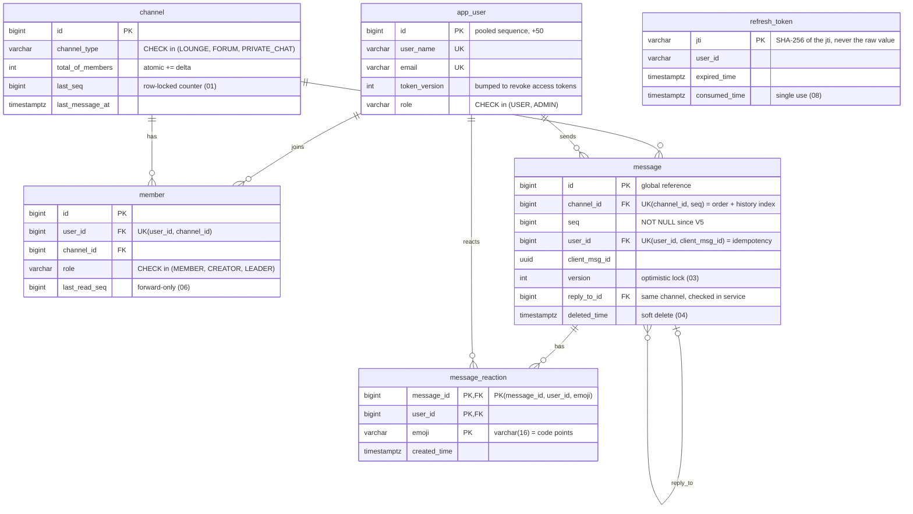

# 00 — Core schema and constraints

The chat tables after `V7`. Every concurrency technique in this folder relies on one of these keys. The service layer checks first so it can give a friendly error, and the constraint guarantees the rule.

| Constraint | What it guarantees | Used by |
|---|---|---|
| `uk_message_channel_seq (channel_id, seq)` | no two messages share a position; also the history index | [01](01-per-channel-seq.md), [07](07-keyset-history.md) |
| `uk_message_user_client_msg (user_id, client_msg_id)` | one row per send attempt | [02](02-idempotent-send.md) |
| `pk_message_reaction (message_id, user_id, emoji)` | one reaction per user per emoji | [05](05-reactions.md) |
| `uk_member_channel_user (user_id, channel_id)` | a user joins a channel once | [09](09-membership-races.md) |
| `ck_*` CHECKs on enum columns | the DB rejects values the Java enum doesn't know | all |

**Read:** [notes/00-schema.md](notes/00-schema.md)
