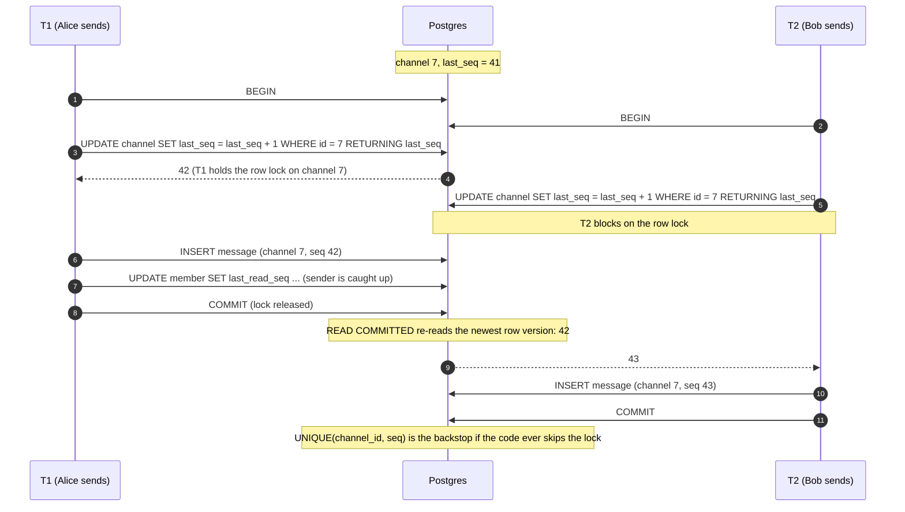
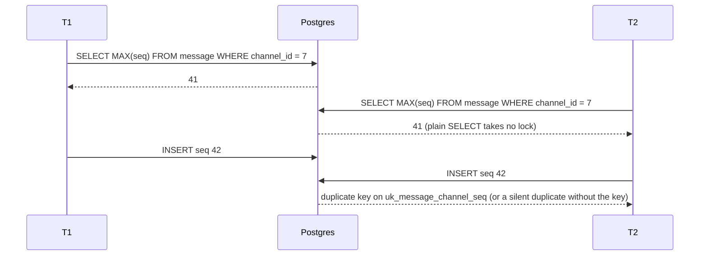

# 01 — Per-channel message sequence

Two members post in the same channel at the same moment. The `UPDATE` on the channel row takes a row lock, so the second sender waits and gets the next number. Seqs are gapless and follow commit order. Senders in *other* channels never wait.

**The naive version** loses an update: both transactions read the same `MAX(seq)` and write the same number.

**Read:** [notes/01-per-channel-seq.md](notes/01-per-channel-seq.md)
