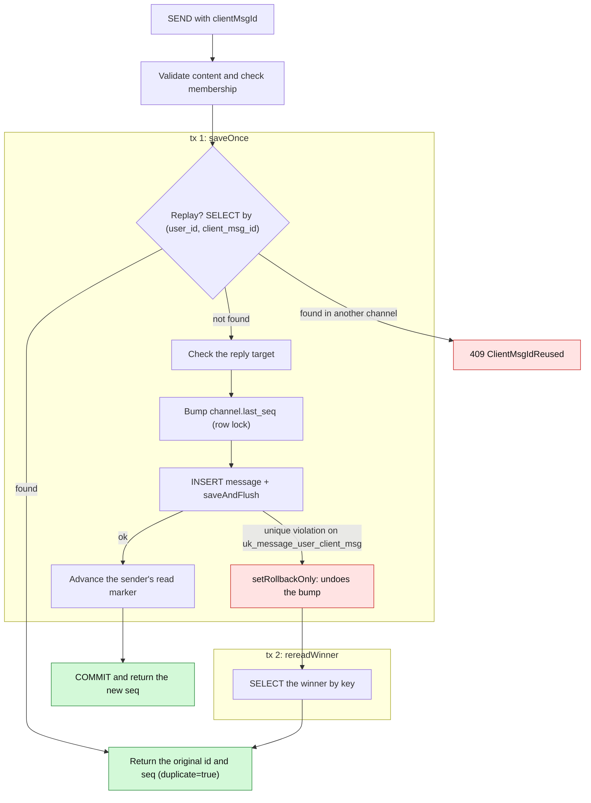
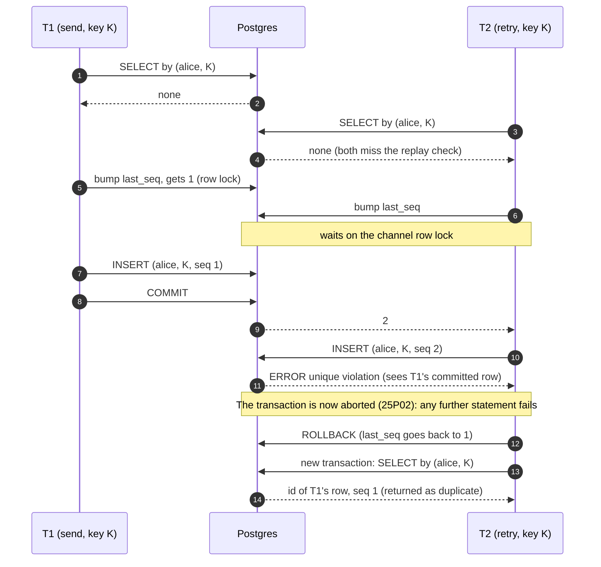

# 02 — Idempotent send (`clientMsgId`)

The client generates a UUID per message and resends it on retry. The unique key `(user_id, client_msg_id)` makes a retry return the original message instead of a duplicate, and a retry never moves `last_seq`.

## The send path

## The retry race (two retries of one key)

**Read:** [notes/02-idempotent-send.md](notes/02-idempotent-send.md)
