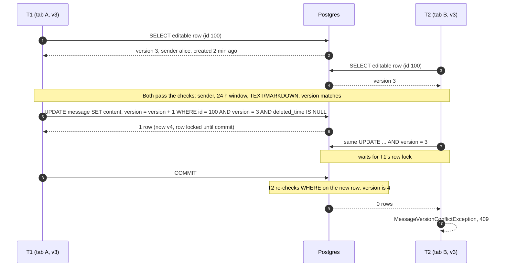
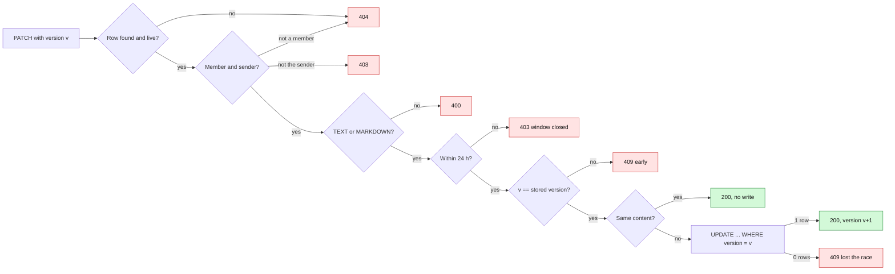

# 03 — Edit with optimistic locking

Two tabs edit the same message, both based on `version = 3`. The UPDATE only matches if the version is still 3, so exactly one edit wins and the other gets **409 Conflict**. Nothing is locked while the user types.

**Read:** [notes/03-optimistic-edit.md](notes/03-optimistic-edit.md)
