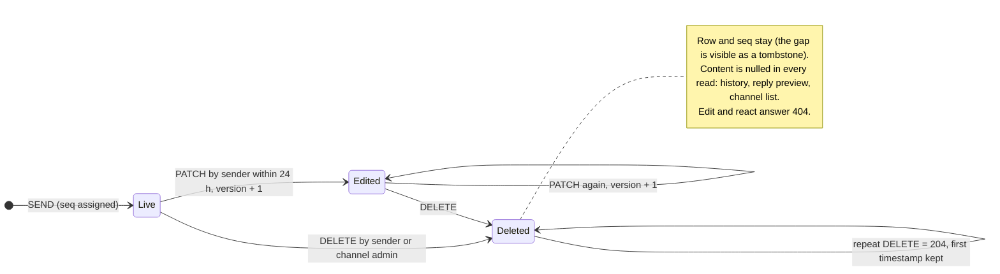
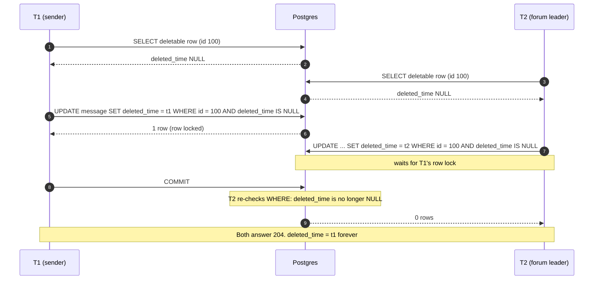

# 04 — Soft delete, idempotent

A message is never removed from the table. Deleting stamps `deleted_time` once: the first delete wins, and every repeat (a retry, a second admin, a double click) answers 204 without changing anything.

## Message lifecycle

## Two admins delete at once

**Read:** [notes/04-soft-delete.md](notes/04-soft-delete.md)
