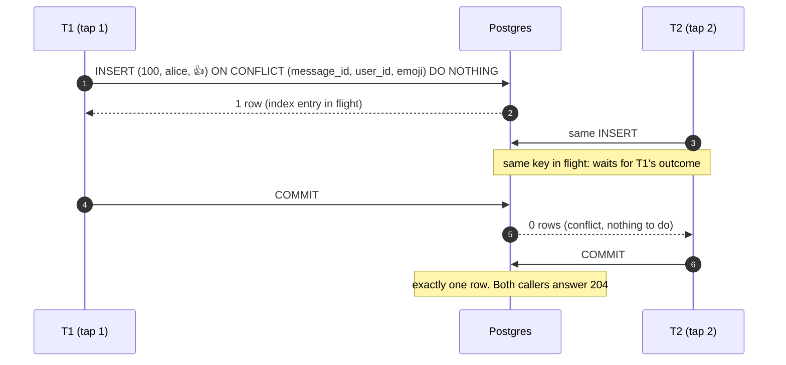
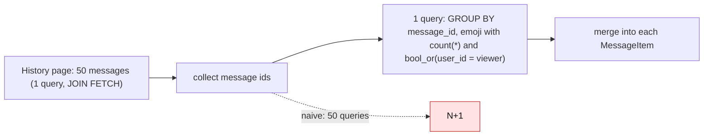
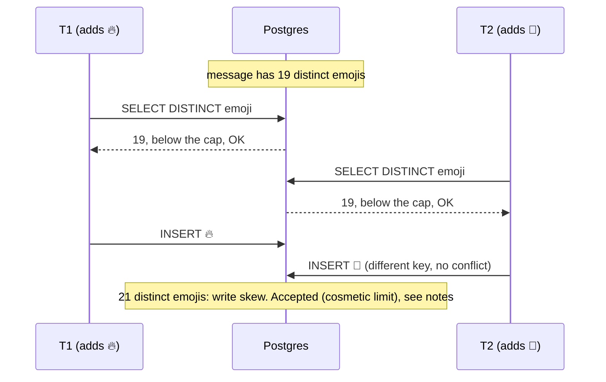

# 05 — Reactions: upsert toggle and one-query counts

A reaction is a row keyed by `(message_id, user_id, emoji)`. Adding the same reaction twice is a no-op thanks to `ON CONFLICT DO NOTHING`. The history page loads every message's counts in **one** grouped query.

## Concurrent double-tap

## Counts for a history page (no N+1)

## Known gap: the 20-emoji cap is check-then-act

**Read:** [notes/05-reactions.md](notes/05-reactions.md)
