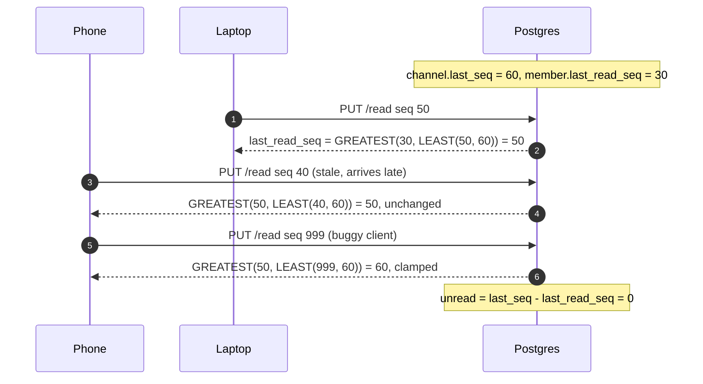
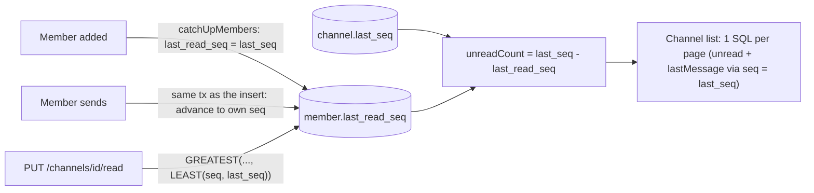

# 06 — Read state and O(1) unread counts

Each member row stores `last_read_seq`. The marker only moves forward and is clamped to the channel's `last_seq`. Unread is a subtraction, not a `COUNT(*)` over messages.

## Out-of-order read markers

## Where the marker moves

**Read:** [notes/06-read-state.md](notes/06-read-state.md)
