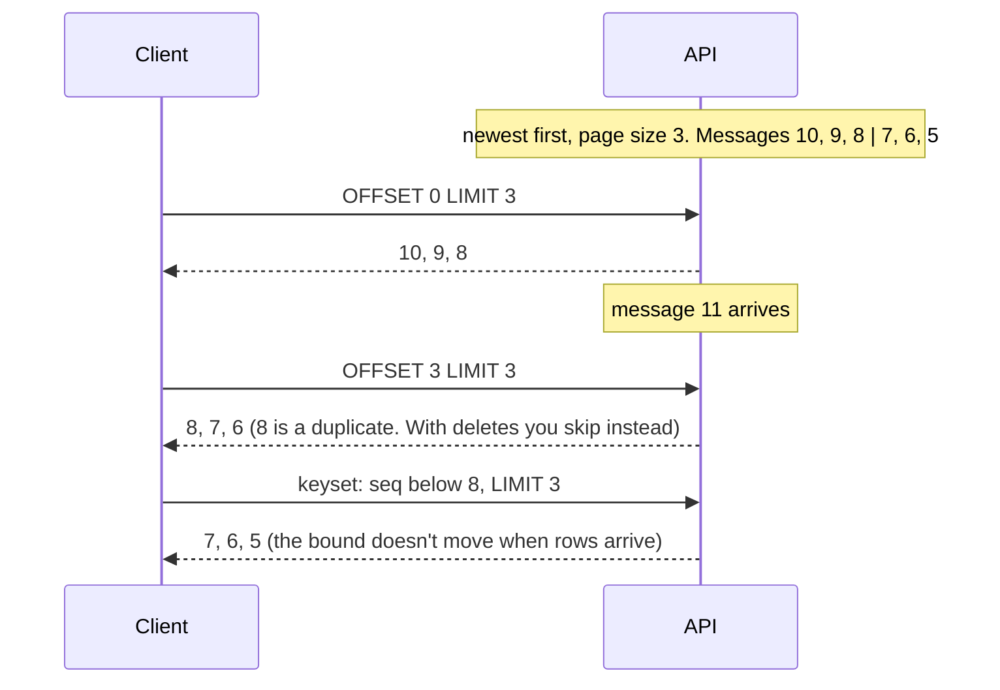
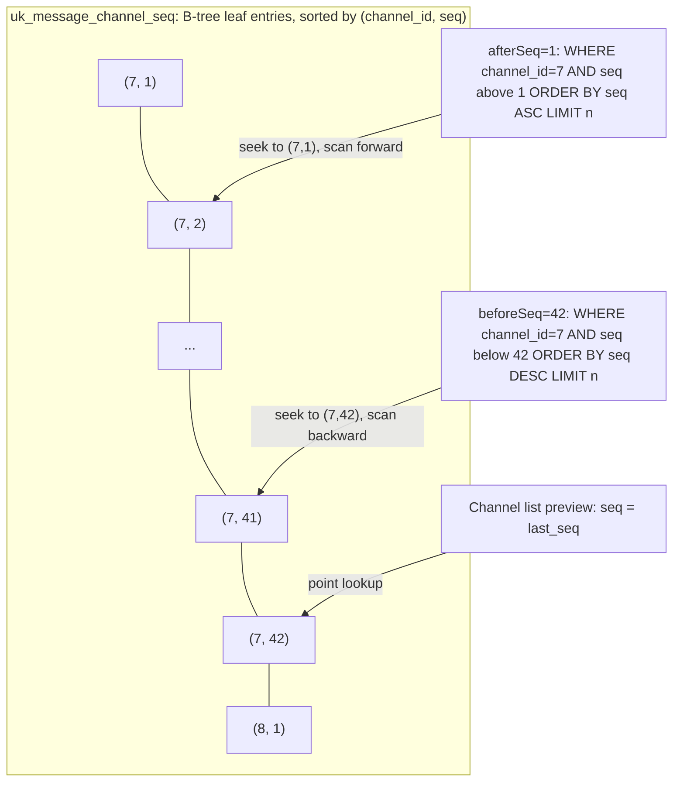

# 07 — History: keyset pagination on `(channel_id, seq)`

Scrolling up asks for "20 messages before seq N" (limit 1–100). Reconnecting asks for "everything after seq N". Both are **seeks** into one B-tree, the unique index that already guarantees ordering. No OFFSET, no sort, and no extra index.

## Why OFFSET breaks while a chat is live

## One index, two directions

**Read:** [notes/07-keyset-history.md](notes/07-keyset-history.md)
