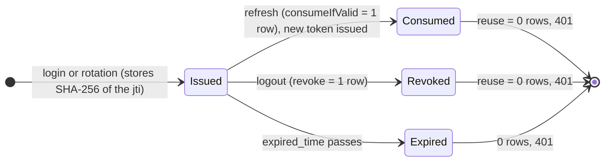
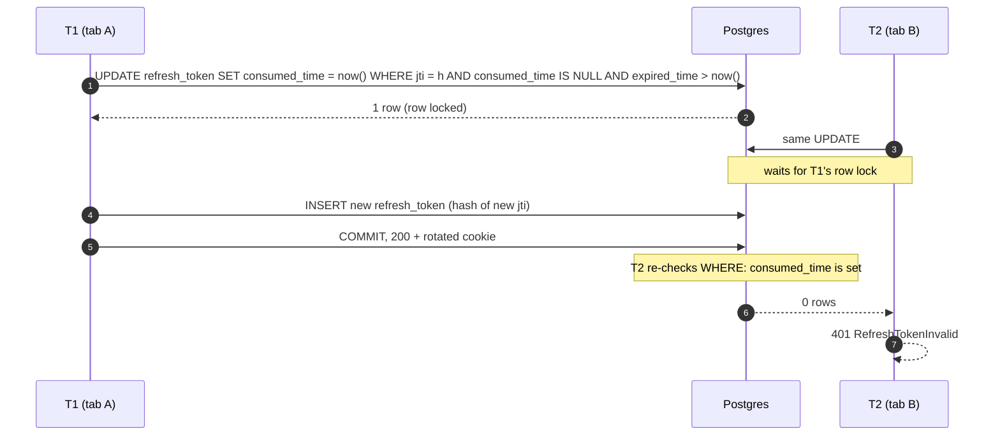

# 08 — Refresh-token rotation: single use by conditional UPDATE

Each refresh token works **exactly once**. Consuming it is one UPDATE that matches only an unconsumed, unexpired row. Two concurrent refreshes with the same cookie get one winner, and the other gets 401.

## Token lifecycle

## Two tabs refresh with the same cookie

**Read:** [notes/08-refresh-token.md](notes/08-refresh-token.md)
