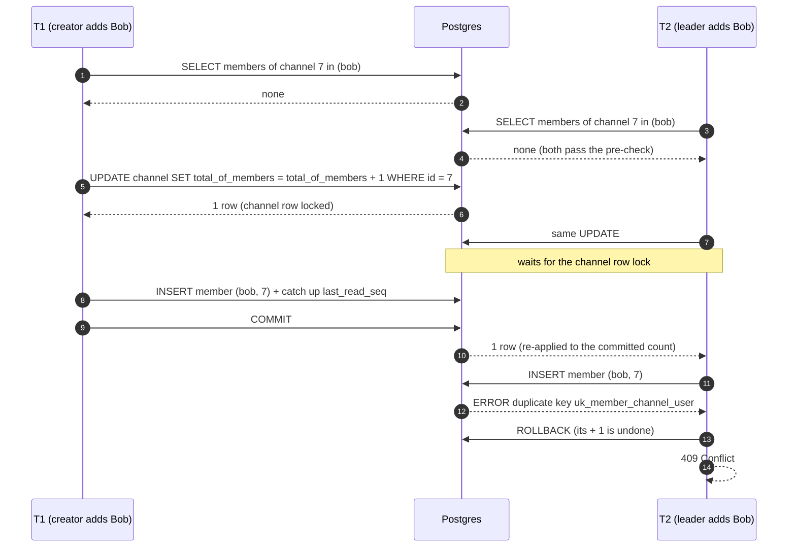
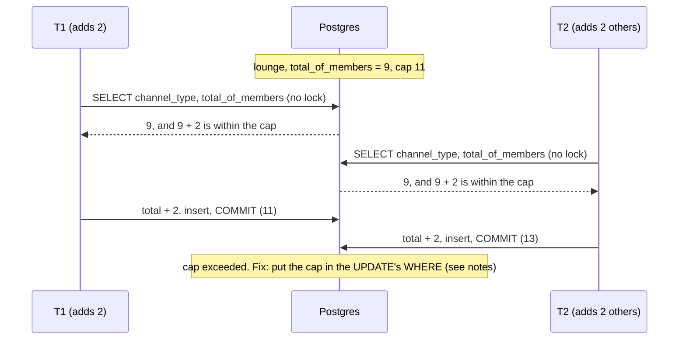

# 09 — Membership races: pre-check for the message, constraint for the truth

Adding members checks "already a member?" in Java for a precise error, but two concurrent adds can both pass that check. `UNIQUE(user_id, channel_id)` stops the duplicate and the handler turns it into 409. The member counter uses an atomic `+ delta` and rolls back with the failed insert.

## Duplicate add race

## Known gap: the lounge cap reads the count before the lock

**Read:** [notes/09-membership-races.md](notes/09-membership-races.md)
