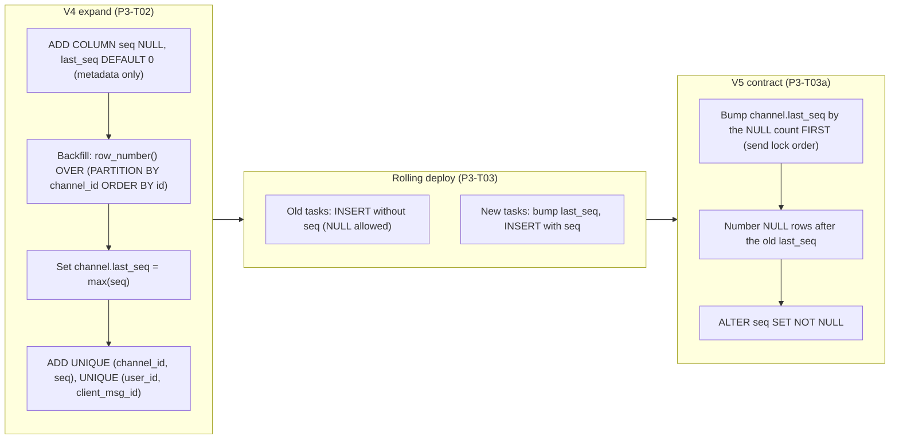
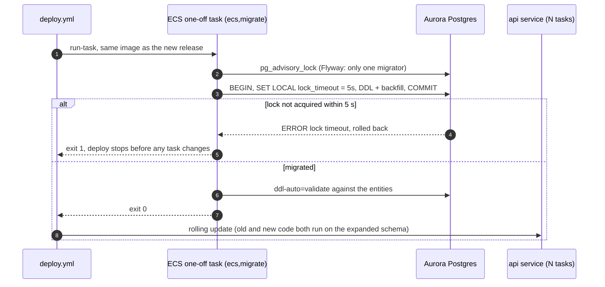

# 10 — Zero-downtime migrations: expand → deploy → contract

Adding `message.seq NOT NULL` while old tasks keep inserting without it takes three steps: **expand** (nullable column + backfill), **deploy** the code that writes it, then **contract** (fill the stragglers and set NOT NULL). Every migration caps how long it may wait for a lock.

## The seq rollout (V4 → P3-T03 → V5)

## How a migration reaches production

**Read:** [notes/10-migrations.md](notes/10-migrations.md)
