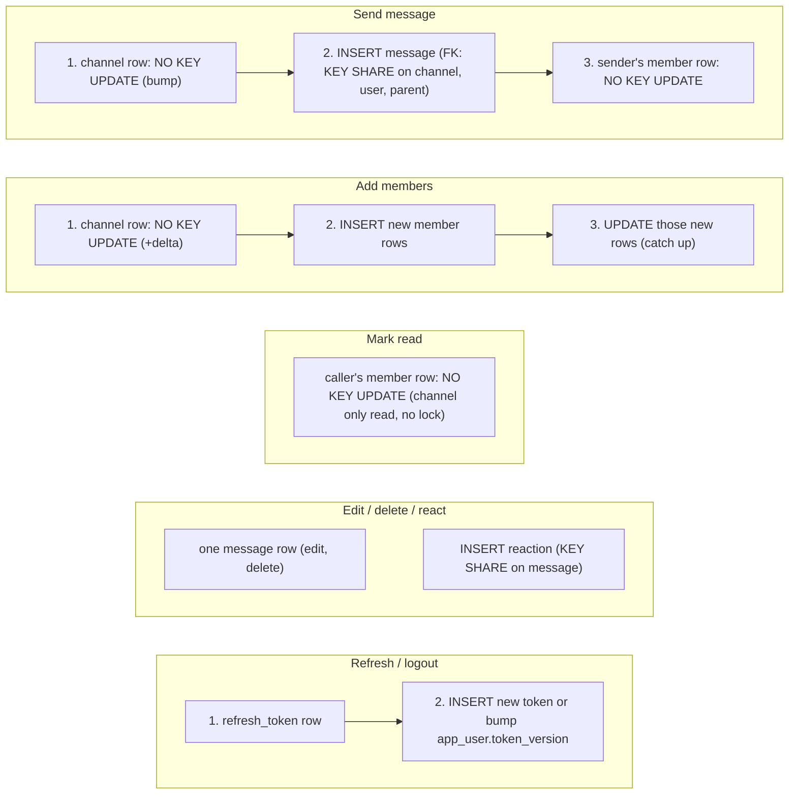
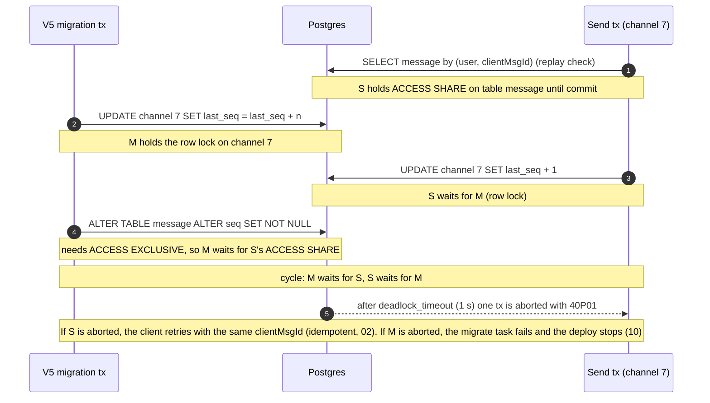

# 11 — Locks, deadlocks and isolation

Everything runs at Postgres's default **READ COMMITTED**. Correctness comes from three tools: **atomic conditional statements**, **one row lock as a serialization point**, and **unique constraints**. Every write path takes its locks in the same order, so the application paths can't deadlock each other.

## Lock order per write path

Rule: **channel → message → member**. No path holds a member row and then asks for a channel row. That reverse order is what a deadlock needs.

## Row-level lock compatibility (why FK checks don't block edits)

| Held \ Requested | FOR KEY SHARE (FK check) | FOR SHARE | FOR NO KEY UPDATE (UPDATE of non-key cols) | FOR UPDATE (DELETE, key change) |
|---|---|---|---|---|
| **FOR KEY SHARE** | ✓ | ✓ | ✓ | ✗ |
| **FOR SHARE** | ✓ | ✓ | ✗ | ✗ |
| **FOR NO KEY UPDATE** | ✓ | ✗ | ✗ | ✗ |
| **FOR UPDATE** | ✗ | ✗ | ✗ | ✗ |

A send's `UPDATE channel` (NO KEY UPDATE) and another send's FK check on that channel (KEY SHARE) don't conflict, and neither do a soft delete of a message and a reaction or reply that points at it.

## A deadlock that *could* happen: V5 contract vs a live send

**Read:** [notes/11-locks-and-isolation.md](notes/11-locks-and-isolation.md)
