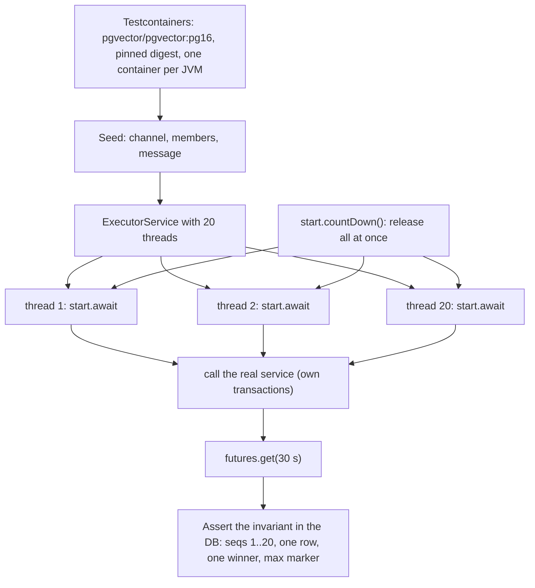

# 12 — Testing concurrency on a real Postgres

Every race in this folder has a test that **actually races**: 20 threads released by one latch against the same pgvector Postgres 16 image that production runs, plus statement-count assertions for N+1 and version-targeted migration tests.

## Race test anatomy

| Test | Races | Invariant asserted |
|---|---|---|
| `SendMessageSeqIT.parallelSends_getGaplessSeqs` | 20 sends, one channel | seqs are exactly 1..20, `last_seq` = 20 |
| `SendMessageSeqIT.concurrentRetriesOfOneKey_storeOneRow_andBumpOnce` | 20 sends, one `clientMsgId` | 1 row, all callers get seq 1, one non-duplicate, `last_seq` = 1 |
| `EditMessageConcurrencyIT.concurrentEditsOnOneVersion_exactlyOneWins` | 20 edits on version 0 | exactly 1 wins, the other 19 throw `MessageVersionConflictException` (409) |
| `DeleteMessageIT.concurrentDeletes_allSucceed_oneTimestamp` | 20 deletes by the sender | no call fails, `deleted_time` set (first-timestamp-kept is `repeatDelete_…`) |
| `MessageReactionIT.concurrentReacts_sameUserAndEmoji_leaveOneRow` | 20 identical reacts | one row |
| `ChannelReadIT.concurrentReads_endAtTheHighestSeq` | 20 markers, seqs 1..20 | `last_read_seq` = 20 whatever the commit order |

**Read:** [notes/12-concurrency-tests.md](notes/12-concurrency-tests.md)
