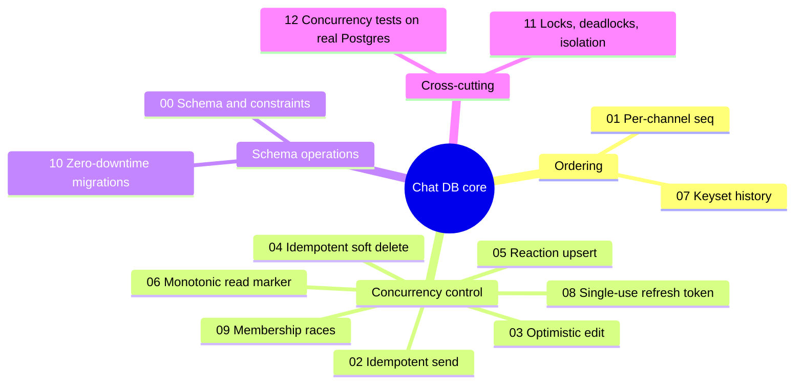

# DevCool database diagrams

The core database techniques behind the chat backend built in P1–P3, one diagram per technique. Each diagram links to a notes file that covers the logic, the DB concepts, the trade-offs, interview questions and a blog angle.

- **Diagrams** (`NN-*.md`) are short. Show them to employers or embed them in a post.
- **Notes** (`notes/NN-*.md`) explain them. Read these to review before an interview.
- **[`notes/concepts.md`](notes/concepts.md)** is the review sheet: each DB concept and the features that use it.

All diagrams are Mermaid, so they render on GitHub and in most blog engines.

## Feature map

## Index

| # | Diagram | Technique in one line | Key concepts | Proven by |
|---|---|---|---|---|
| 00 | [Schema](00-schema.md) | Constraints are the last line of defence | PK/FK/UNIQUE/CHECK, composite keys | `V1`–`V7` + `ddl-auto=validate` |
| 01 | [Per-channel seq](01-per-channel-seq.md) | A row-locked counter gives gapless per-channel order | row lock, `UPDATE … RETURNING`, lost update | `SendMessageSeqIT` |
| 02 | [Idempotent send](02-idempotent-send.md) | A unique key turns retries into replays | unique constraint, aborted transaction, rollback | `SendMessageSeqIT` |
| 03 | [Optimistic edit](03-optimistic-edit.md) | Compare-and-set on `version` → 409 | optimistic locking, READ COMMITTED re-check | `EditMessageConcurrencyIT` |
| 04 | [Soft delete](04-soft-delete.md) | A conditional UPDATE: the first delete wins, repeats are no-ops | idempotency, soft delete, tombstones | `DeleteMessageIT` |
| 05 | [Reactions](05-reactions.md) | Composite PK + `ON CONFLICT DO NOTHING`, one grouped query | upsert, aggregation, N+1, write skew | `ReactionAdapterIT`, `MessageReactionIT` |
| 06 | [Read state](06-read-state.md) | `GREATEST` marker, unread = subtraction | monotonic update, denormalized counter | `MemberAdapterIT`, `ChannelReadIT` |
| 07 | [Keyset history](07-keyset-history.md) | Seek on `(channel_id, seq)`, never OFFSET | composite B-tree, backward scan, JOIN FETCH | `MessageAdapterIT` |
| 08 | [Refresh token](08-refresh-token.md) | Atomic consume: a token works exactly once | conditional UPDATE, TOCTOU, hashing at rest | `AuthFlowIT` |
| 09 | [Membership races](09-membership-races.md) | Pre-check for messages, constraint for truth | check-then-act, atomic increment | `ApiExceptionHandlerTest` (mapping only; the race isn't IT-tested) |
| 10 | [Migrations](10-migrations.md) | Expand → deploy → contract, with `lock_timeout` | Flyway, DDL locks, backfill, advisory lock | `V4BackfillIT`, `V5ContractIT` |
| 11 | [Locks and isolation](11-locks-and-isolation.md) | One lock order, READ COMMITTED + atomic statements | MVCC, lock modes, deadlock, isolation levels | analysis (see notes) |
| 12 | [Concurrency tests](12-concurrency-tests.md) | 20 threads, one latch, a real Postgres | Testcontainers, statement counting | the `*IT` above |

## Suggested reading order
- **Interview prep:** 01 → 02 → 03 → 11 → 06 → 07 → 10, then `notes/concepts.md`.
- **Blog series:** 01 + 02 ("Ordering and idempotency in a chat app"), 03 + 04 + 08 ("Conditional UPDATE is the most underrated lock"), 10 ("Zero-downtime migrations in practice"), 11 ("Why I didn't need SERIALIZABLE").

## Conventions
- In a race diagram, **T1** and **T2** are two concurrent transactions and **PG** is Postgres.
- SQL in the notes is copied from the repo. Code links point to `src/main/java/com/devcool/…`.
- Every notes file has the same sections: Problem → Without it → Mechanism → Concepts → Trade-offs → Interview Q&A → Blog angle → Code.
