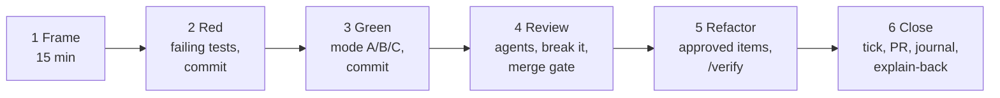

# §3 The task loop

[← Playbook](../delivery-playbook.md)

One task = one PR.

1. **Frame (15 min).** Run `/frame-task Pn-Tmm`. Give your **prediction** when it asks: invariants, a design sketch, the test list (mode C: the acceptance criteria). The first time you meet a topic, read the "Read first" of its [reference file](../../references/README.md) (cap: 60 min).
2. **Red (10–30 min).** Run `/implement-task Pn-Tmm` in the task's mode. Claude maps each **Done when** item to a named test.
   - Compare its plan and test list with your prediction. Write down whether each difference was a gap in your knowledge or a mistake in Claude's plan.
   - Each test must fail on an assertion, not a compile error. Committed as `test(<id>)`; don't push yet.
3. **Green.** The simplest code that passes, with the Red tests frozen. In mode A, answer the `TODO(human)` requests yourself; ask questions, don't ask it to "just do it". Committed as `feat(<id>)`.
4. **Review.** Reviewer agents run by path (`hexagonal-reviewer`, `security-reviewer`, `aws-architect`); you approve or reject each finding.
   - **Break it on purpose** (A/B): remove the row lock, drop the `ON CONFLICT`, skip the membership check. The right test must fail.
   - Pass the merge gate (below).
5. **Refactor.** Only the approved items plus behaviour-preserving cleanups, tests green, then `/verify`.
6. **Close.** Tick the task (`refactor(<id>)`), open the PR, get CI green. Write a 10-minute [journal entry](09-journal-templates.md). **Explain-back:** answer the reference file's Self-check without notes; every miss goes on Friday's list.

## Merge gate

Answer out loud or in the journal. If you can't answer one, you don't merge.

1. **What does it do?** In two sentences, without reading the code.
2. **Why this way?** Which ADR or trade-off, and the option you didn't take.
3. **How does it fail, and how would I know?** The test that covers it; the metric or log that would show it.

## Prompts

| When | Prompt |
|---|---|
| Review, not rewrite | `Review my changes in <files> for race conditions, missing authorization and missing tests. Point at lines and explain the failure. Don't rewrite the code.` |
| Break it | `Suggest three one-line changes that would break the invariant in <class>, and for each, the test that should catch it. Don't apply them.` |
| Grill me | `Act as a senior backend interviewer. Ask me one question at a time about <topic> in DevCool, broad first, then follow-ups. Don't give answers until I've tried. After 8 questions, score me and list the gaps with the files to read.` |
| Incident report | `Here is my game-day log: <paste>. Fill the incident template from docs/plans/delivery-book/09-journal-templates.md. Ask for anything missing; don't invent timings or numbers.` |
| Story | `Turn these journal entries <paths> into a STAR story under 250 words, using only numbers that appear in them. Mark anything you'd need me to confirm.` |
